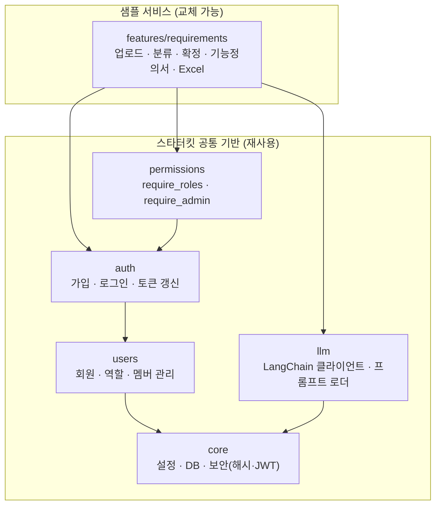

# MeerKit 아키텍처

## 1. 목표

이 저장소는 두 가지를 함께 담고 있습니다.

1. **스타터킷 공통 기반**: 어떤 AI 서비스를 만들든 필요한 설정, DB, 인증, 예외 처리, 로깅, LLM 호출, CI
2. **샘플 서비스**: 공통 기반 위에 만든 예시 기능 "요구사항 정리 도우미"

다른 사람이 이 저장소를 Fork 했을 때 **샘플 폴더만 지우고 자기 기능을 추가**하면 되도록, 두 영역을 폴더로 분리합니다.

## 2. 의존 방향 규칙



- 화살표는 "import 한다"는 뜻입니다.
- **킷(`core`, `users`, `auth`, `permissions`, `llm`)은 `features/`를 절대 import 하지 않습니다.** `tests/test_import_rules.py`가 검사합니다.
- `features/` 안의 기능끼리도 서로 import 하지 않습니다. 공통으로 필요해지면 공통 기반으로 올립니다.
- 각 모듈 안에서는 `router → service → repository` 방향으로만 import 합니다.
- 프론트엔드도 같습니다: 킷(`src/meerkit`)은 `src/app`(라우트·서비스 화면)을 import 하지 않고, `src/app`은 킷을 `@/meerkit`(공개 API)으로만 씁니다. ESLint가 검사합니다.

## 3. 백엔드 구조

```text
backend/
├── app/
│   ├── main.py            # create_app(): 미들웨어, 라우터 등록
│   ├── api.py             # 모든 라우터를 한 곳에서 include (킷 → 서비스 순)
│   ├── core/
│   │   ├── config.py      # pydantic-settings, .env 로딩
│   │   ├── database.py    # engine, SessionLocal, Base, get_db
│   │   ├── security.py    # 비밀번호 해시(argon2), JWT 발급/검증
│   │   └── models.py      # TimestampMixin 등 공통 컬럼
│   ├── users/             # 회원·역할 (킷)
│   │   ├── models.py      # User, Role, UserRole (users / roles / user_roles)
│   │   ├── repository.py  # 쿼리
│   │   ├── service.py     # 가입, 역할 변경, 활성/비활성 규칙
│   │   ├── schemas.py
│   │   ├── router.py      # /api/users (관리자 전용)
│   │   └── seed.py        # 로컬 테스트용 관리자 계정 만들기
│   ├── auth/              # 가입·로그인·토큰 갱신 (킷)
│   │   ├── router.py      # /api/auth/signup, login, refresh, logout, me
│   │   ├── service.py
│   │   ├── schemas.py
│   │   └── deps.py        # get_current_user
│   ├── permissions/       # 권한 검사 (킷)
│   │   ├── roles.py       # USER, ADMIN
│   │   └── deps.py        # require_roles(), require_admin
│   ├── llm/
│   │   ├── client.py      # get_chat_model(): 설정값으로 모델 생성
│   │   ├── prompts.py     # 프롬프트 파일 로더
│   │   └── structured.py  # Pydantic 스키마로 구조화 출력 받기
│   └── features/
│       └── requirements/
│           ├── router.py
│           ├── service.py
│           ├── repository.py  # DB를 쓰기 시작하면 추가
│           ├── schemas.py
│           ├── models.py
│           ├── parser.py      # MarkItDown: txt/docx/pdf → 텍스트
│           ├── chains.py      # 분류, 정제, 기능정의서 생성 체인
│           ├── prompts/       # *.md 프롬프트
│           ├── excel.py       # openpyxl로 표준 템플릿 채우기
│           └── templates/     # 고정 표준 Excel 템플릿
├── alembic/
└── tests/
    ├── conftest.py        # 테스트 DB(테스트마다 롤백), TestClient, 로그인 헬퍼
    ├── kit/               # auth, users 테스트
    └── features/
```

### 인증 방식

| 항목 | 방식 |
|---|---|
| 액세스 토큰 | JWT, 응답 본문으로 전달. 프론트는 **메모리**(Zustand)에만 보관. 유효 30분 |
| 리프레시 토큰 | JWT, **httpOnly 쿠키**(`meerkit_refresh`, 경로 `/api/auth`). 자바스크립트로 읽을 수 없음. 유효 14일 |
| 새로고침 | 프론트가 시작할 때 `/api/auth/refresh`를 불러 액세스 토큰을 다시 받음 |
| 역할 확인 | 토큰에는 사용자 id만 넣고, 역할은 요청마다 DB에서 읽음 → 역할 변경이 바로 반영 |
| 비활성 계정 | 로그인, 토큰 사용, 갱신 모두 거부 |

### 기능 폴더 안의 역할 나누기

| 파일 | 하는 일 | 하지 않는 일 |
|---|---|---|
| `router.py` | URL, 요청/응답 스키마, 권한 체크 | DB 쿼리, LLM 호출 |
| `service.py` | 업무 흐름 (저장, 상태 변경, 체인 호출 순서) | HTTP 관련 처리, SQL |
| `repository.py` | DB 쿼리 | 업무 규칙 |
| `schemas.py` | API 입출력 Pydantic 모델 | DB 접근 |
| `models.py` | SQLAlchemy 테이블 | 비즈니스 로직 |
| `chains.py` | 프롬프트 + 모델 + 출력 파싱 조합 | DB 접근 |

## 4. 프론트엔드 구조 (Next.js + shadcn + Tailwind)

```text
frontend/
├── components.json             # shadcn 설정
├── next.config.ts              # /api → backend 프록시(rewrites)
├── postcss.config.mjs          # Tailwind
├── .env.example                # NEXT_PUBLIC_API_BASE_URL, NEXT_PUBLIC_DOCS_URL, API_PROXY_TARGET
├── public/                     # 로고(meerkit-logo.svg)
└── src/
    ├── meerkit/                # ← 킷 본체
    │   ├── index.ts            # 공개 API (킷 밖에서는 여기서만 import)
    │   ├── config.ts           # API 주소, 사용 설명서 URL, 라우트 경로
    │   ├── types.ts            # User, RoleCode
    │   ├── api/                # client.ts(토큰 부착, 401 시 갱신 후 재시도), auth.ts, users.ts
    │   ├── providers/          # MeerkitProvider: QueryClient + 로그인 복원 + AuthDialog + Toaster
    │   ├── styles/tokens.css   # MeerKit 색상·반경·폰트 토큰
    │   ├── welcome/            # WelcomePage (초기 화면)
    │   ├── components/         # KitHeader
    │   ├── auth/
    │   │   ├── store.ts        # Zustand: 액세스 토큰, 인증 상태
    │   │   ├── dialog-store.ts # Zustand: 모달 열림 여부, 로그인/가입 모드
    │   │   ├── queries.ts      # useMe
    │   │   ├── mutations.ts    # useLogin, useSignup, useLogout
    │   │   ├── hooks.ts        # useAuth, usePermission
    │   │   ├── guards/         # RequireAuth, RequireRole
    │   │   └── components/     # AuthDialog, LoginForm, SignupForm, UserMenu, MyInfo
    │   └── admin/
    │       ├── queries.ts      # useMembers, useUpdateRole, useUpdateActive
    │       └── components/     # MemberTable, RoleSelect
    ├── app/                    # ← 라우트 (사용자의 영역)
    │   ├── layout.tsx          # <MeerkitProvider>로 감싸기
    │   ├── globals.css         # Tailwind + tokens.css
    │   ├── page.tsx            # <WelcomePage /> (사용자가 가장 먼저 교체하는 파일)
    │   ├── (meerkit)/          # 킷 화면: /me, /admin/members (괄호 폴더는 URL에 안 나타남)
    │   └── (service)/          # 서비스 화면 자리
    ├── components/ui/          # shadcn 컴포넌트
    └── lib/utils.ts            # shadcn의 cn()
```

### 상태 분리

| 구분 | 담는 것 | 도구 |
|---|---|---|
| 클라이언트 상태 | 액세스 토큰, 인증 진행 상태, 모달 열림·모드 | Zustand |
| 서버 상태 | 내 정보, 멤버 목록 | TanStack Query |

- 내 정보는 `useMe()` 쿼리 하나로만 가져오고 Zustand에 복사하지 않습니다.
- 토큰 스토어는 `persist`를 쓰지 않습니다. 새로고침 후에는 갱신 요청으로 복원합니다.

### 스타일

- Tailwind utility로 작성하고, 별도 CSS 파일은 `meerkit/styles/tokens.css`만 둡니다 (`globals.css`는 연결만).
- 색·반경·폰트는 토큰으로 정의하고 utility 이름으로 씁니다. 예: `bg-primary`, `bg-sand-50`, `rounded-md`
- UI 부품은 shadcn(`components/ui`)을 먼저 씁니다.

## 5. 공통 규칙

### 설정
- 모든 설정은 `app/core/config.py`의 `settings`를 통해 읽습니다. 코드에서 `os.environ`을 직접 읽지 않습니다.
- 비밀값(API 키, JWT 키)은 `.env`에만 두고, `.env.example`에는 항목 이름만 둡니다.

### 예외 처리
- service는 업무 오류를 예외(`UserError`, `AuthError` 등)로 던지고, router가 HTTP 상태 코드로 바꿉니다.
- 응답 형식: `{"detail": "사용자에게 보여 줄 문구"}` (FastAPI 기본 형식)

### LLM 호출
- 기능 코드는 `llm.client.get_chat_model()`로만 모델을 얻습니다. 공급자를 바꿀 때 `llm/` 한 곳만 고치면 됩니다.
- 출력은 가능하면 Pydantic 스키마로 구조화해서 받습니다.
- 테스트에서는 Fake 모델로 바꿔 끼워 실제 API를 호출하지 않습니다. 그래서 CI에 API 키가 필요 없습니다.

### DB
- 테이블 변경은 반드시 Alembic 마이그레이션으로 합니다.
- 마이그레이션 파일은 한 번에 한 사람만 만듭니다 (충돌 방지).

## 6. 기능을 추가할 때 고치는 곳

공통 기반을 건드리지 않고 아래 세 곳만 추가·수정합니다.

| 파일 | 수정 내용 |
|---|---|
| `backend/app/api.py` | 새 기능 라우터 include 한 줄 |
| `backend/alembic/env.py` | 새 기능 모델 import 한 줄 |
| `frontend/src/app/(service)/<기능>/` | 새 기능 화면 폴더: `page.tsx`와 화면 부품 `_components/` (킷은 `@/meerkit`으로만 사용) |

자세한 순서는 [how-to-add-feature.md](how-to-add-feature.md)를 보세요.

## 7. 기술 선택 이유

| 항목 | 선택 | 이유 |
|---|---|---|
| 패키지 관리 | uv | 빠르고 `uv.lock`으로 팀원 간 버전이 정확히 일치 |
| 프론트 | Next.js (App Router) + React + TS | 폴더 구조가 곧 URL이라 라우팅 설정이 없고, 배포 방식이 표준화됨 |
| 스타일 | Tailwind CSS + shadcn/ui | 컴포넌트 코드를 저장소에 복사해 두는 방식이라 디자인을 마음대로 바꿀 수 있음 |
| 클라이언트 상태 | Zustand | 토큰·모달처럼 작은 상태에 Provider 없이 쓸 수 있음 |
| 서버 상태 | TanStack Query | 캐시, 재요청, 로딩·오류 상태를 직접 만들 필요가 없음 |
| 토큰 저장 | 액세스: 메모리 / 리프레시: httpOnly 쿠키 | localStorage보다 XSS에 안전. `/api` 프록시 덕분에 같은 도메인이라 쿠키가 그대로 동작 |
| DB 접근 | SQLAlchemy 2.0 동기 | 비동기보다 디버깅이 쉬움 |
| 비밀번호 해시 | pwdlib[argon2] | passlib 유지보수 중단, FastAPI 공식 문서 기준 |
| 문서 파싱 | MarkItDown | txt/docx/pdf를 하나의 API로 처리 |
| Excel | openpyxl | 고정 템플릿에 값 채우기에 충분 |
| 로컬 DB | Docker Compose | 팀원 간 DB 버전과 설정을 동일하게 유지 |
