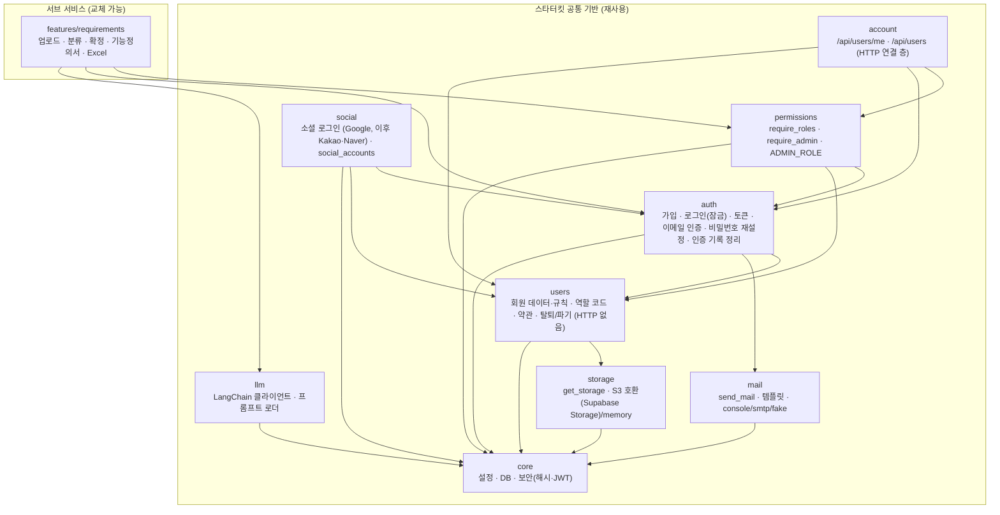

# MeerKit 아키텍처

## 1. 목표

이 저장소는 두 가지를 함께 담고 있습니다.

1. **스타터킷 공통 기반**: 어떤 AI 서비스를 만들든 필요한 설정, DB, 인증, 예외 처리, 로깅, LLM 호출, CI
2. **서브 서비스**: 공통 기반 위에 만든 서비스 "매무새"(요구사항 정리 도우미)

다른 사람이 이 저장소를 Fork 했을 때 **서브 서비스 폴더만 지우고 자기 기능을 추가**하면 되도록, 두 영역을 폴더로 분리합니다.

## 2. 의존 방향 규칙



- **공통 모듈끼리도 한 방향으로만 의존합니다:** `core ← users ← auth ← permissions ← account`, `mail`·`llm`·`storage`는 `core`만(`users`는 프로필 이미지 때문에 `storage`를 씀). `social`은 `core`·`users`·`auth`만 쓰고, `social`을 import 하는 킷은 없습니다(`app/api.py`만 라우터 등록). 서로 참조(↔)나 역방향 import는 `tests/test_import_rules.py`의 층 표(`ALLOWED_KIT_IMPORTS`)가 막습니다. 표를 바꿔야 하면 팀과 먼저 협의합니다.
- `users`에는 HTTP(라우터)를 두지 않습니다. 로그인 확인(auth)과 권한 검사(permissions)가 함께 필요한 회원 API는 맨 위 `account`가 조합합니다(Spring의 Controller 패키지 역할).

- 화살표는 "import 한다"는 뜻입니다.
- **킷(`core`, `users`, `auth`, `permissions`, `account`, `social`, `llm`, `mail`, `storage`)은 `features/`를 절대 import 하지 않습니다.** `tests/test_import_rules.py`가 검사합니다.
- `features/` 안의 기능끼리도 서로 import 하지 않습니다. 공통으로 필요해지면 공통 기반으로 올립니다.
- 각 모듈 안에서는 `router → service → repository` 방향으로만 import 합니다.
- 프론트엔드도 같습니다: 킷(`src/meerkit`)은 `src/app`(라우트·서비스 화면)을 import 하지 않고, `src/app`은 킷을 `@/meerkit`(공개 API)으로만 씁니다. ESLint가 검사합니다.

## 3. 백엔드 구조

```text
backend/
├── app/
│   ├── main.py            # create_app(): 미들웨어, 라우터 등록
│   ├── api.py             # 모든 라우터를 한 곳에서 include (킷 → 서비스 순)
│   ├── core/
│   │   ├── config.py      # pydantic-settings, .env 로딩
│   │   ├── database.py    # engine, SessionLocal, Base, get_db
│   │   ├── security.py    # 비밀번호 해시(argon2), JWT 발급/검증, 일회용 코드·토큰(HMAC 해시)
│   │   ├── exceptions.py  # AppError와 하위 예외, 전역 예외 핸들러 (오류 응답 형식 통일)
│   │   ├── middleware.py  # 요청 ID 발급, 접근 로그, 처리 못 한 예외 → 500 JSON
│   │   ├── request_context.py  # 요청 ID(ContextVar)
│   │   ├── logging.py     # app.* 로거 설정 (JSON/text, 모든 줄에 request_id)
│   │   └── models.py      # TimestampMixin 등 공통 컬럼
│   ├── users/             # 회원 데이터와 규칙 (킷, HTTP 없음, core만 import)
│   │   ├── models.py      # User, Role, UserRole, Term, UserTermAgreement
│   │   ├── repository.py  # 쿼리 (멤버 검색·페이지 포함)
│   │   ├── service.py     # 가입, 약관 확인, 내 정보, 탈퇴, 역할 변경, 활성/비활성, 개인정보 파기
│   │   ├── schemas.py     # 응답·요청 모델, 선택 항목 규칙(OPTIONAL_PROFILE_FIELDS, blank_to_none)
│   │   ├── roles.py       # 역할 코드 MASTER, OWNER, VIEWER, WRITER, DEFAULT_ROLE
│   │   ├── purge.py       # 보관 기간이 지난 탈퇴 계정 개인정보 삭제 (매일 실행)
│   │   └── seed.py        # 로컬 테스트용 관리자(MASTER) 계정 만들기
│   ├── auth/              # 가입·로그인·토큰·이메일 인증·비밀번호 재설정 (킷)
│   │   ├── models.py      # EmailVerification, PasswordResetToken
│   │   ├── repository.py
│   │   ├── router.py      # /api/auth/...
│   │   ├── service.py     # 로그인 잠금, 인증번호, 재설정 토큰, 메일 횟수 제한
│   │   ├── schemas.py
│   │   ├── cleanup.py     # 탈퇴 회원의 재설정 토큰·오래된 인증번호 기록 정리 (purge 다음에 매일 실행)
│   │   └── deps.py        # get_current_user
│   ├── permissions/       # 권한 검사 (킷)
│   │   ├── roles.py       # ADMIN_ROLE = MASTER (+ users.roles 역할 코드 다시 내보내기)
│   │   └── deps.py        # require_roles(), require_admin
│   ├── account/           # 회원 API(HTTP) 연결 층 (킷)
│   │   ├── me_router.py   # /api/users/me: 내 정보 조회·수정, 프로필 이미지 올리기·삭제, 비밀번호 변경, 탈퇴
│   │   └── admin_router.py  # /api/users: 멤버 검색·역할·활성/비활성·삭제, /api/users/roles
│   ├── social/            # 소셜 로그인 (킷, core·users·auth만 import). 명세는 social-oauth-setup.md
│   │   ├── router.py      # GET /api/auth/{provider}/login · callback (302 응답)
│   │   ├── service.py     # 공급자와 무관한 계정 규칙: 연결 찾기 → 검증된 이메일 연결 → 신규 가입
│   │   ├── state.py       # state·PKCE·약관 동의를 담은 서명 쿠키
│   │   ├── providers/     # 공급자별 파일 (google.py). 새 공급자는 파일 하나 + 목록 한 줄
│   │   ├── config.py      # SOCIAL_REDIRECT_BASE_URL, GOOGLE_CLIENT_ID·SECRET + 운영 검사
│   │   └── cleanup.py     # 개인정보를 지운 회원의 소셜 연결 삭제
│   ├── mail/              # 메일 발송 (킷). 어디서든 send_mail 하나로 사용
│   │   ├── service.py     # send_mail(to, template, data): 실패해도 예외 없이 False + 로그
│   │   ├── templates.py   # email_code, password_reset (한글 텍스트 + HTML) + register_template(서비스 양식 등록)
│   │   └── backends.py    # console / smtp / fake (MAIL_BACKEND)
│   ├── storage/           # 파일 저장소 (킷, core만 import). 설정 순서는 storage-setup.md
│   │   ├── config.py      # STORAGE_* 설정 + 운영 검사(memory 금지, localhost 주소 금지)
│   │   └── backends.py    # get_storage(): s3(Supabase Storage·S3·R2) / memory(테스트), override_storage()
│   ├── llm/               # LLM 공통 모듈 (킷, core만 import)
│   │   ├── config.py      # LLM 설정(LLM_PROVIDER, LLM_MODEL, OPENAI_API_KEY 등) + 운영 검사(fake 금지)
│   │   ├── client.py      # get_chat_model(): 설정값으로 모델 생성, override_chat_model(): 테스트용 교체
│   │   ├── prompts.py     # load_prompt(): 마크다운(## system / ## user) → ChatPromptTemplate
│   │   ├── structured.py  # invoke_structured(): Pydantic 스키마로 답 받기 (형식 재시도·입력 상한·로그)
│   │   ├── errors.py      # LLMError(AppError)와 공급자 오류 → 사용자 문구 변환
│   │   └── testing.py     # FakeChatModel: 키 없이 정해 둔 응답 (테스트, LLM_PROVIDER=fake)
│   └── features/
│       └── requirements/
│           ├── router.py
│           ├── service.py
│           ├── repository.py  # DB를 쓰기 시작하면 추가
│           ├── schemas.py
│           ├── models.py
│           ├── parser.py      # MarkItDown: txt/docx/pdf → 텍스트
│           ├── chains.py      # 분류, 정제, 기능정의서 생성 체인
│           ├── prompts/       # *.md 프롬프트
│           ├── excel.py       # openpyxl로 표준 템플릿 채우기
│           └── templates/     # 고정 표준 Excel 템플릿
├── alembic/
└── tests/
    ├── conftest.py        # 테스트 DB(테스트마다 롤백), TestClient, 로그인 헬퍼
    ├── kit/               # auth, users, mail, 잠금, 비밀번호, 파기 테스트
    ├── social/            # 소셜 로그인 (Google 응답은 httpx.MockTransport 로 흉내)
    └── features/
```

### 인증 방식

| 항목 | 방식 |
|---|---|
| 액세스 토큰 | JWT, 응답 본문으로 전달. 프론트는 **메모리**(Zustand)에만 보관. 유효 30분 |
| 리프레시 토큰 | JWT, **httpOnly 쿠키**(`meerkit_refresh`, 경로 `/api/auth`). 자바스크립트로 읽을 수 없음. 유효 14일 |
| 새로고침 | 프론트가 시작할 때 `/api/auth/refresh`를 불러 액세스 토큰을 다시 받음 |
| 로그인 | 아이디(`user_id`, DB 컬럼 `login_id`) + 비밀번호. 이메일은 연락·인증용 |
| 아이디 규칙 | 영문·숫자·밑줄(`_`) 4~30자, 첫 글자는 영문(`^[A-Za-z][A-Za-z0-9_]{3,29}$`), 소문자로 저장. 가입과 중복 확인에만 적용(로그인은 형식 검사 없음). 어긋나면 422 `errors[0].message`에 이유 |
| 역할 확인 | 토큰에는 사용자 id만 넣고, 역할은 요청마다 DB에서 읽음 → 역할 변경이 바로 반영 |
| 비활성·탈퇴 계정 | 로그인, 토큰 사용, 갱신 모두 거부 |
| 비밀번호 변경 | 변경 시각(`password_changed_at`) 이전에 발급된 토큰은 거부 → 다른 기기 로그인이 풀림 |
| 로그인 잠금 | 연속 5회 실패 → 5분 잠금 (`LOGIN_LOCK_*`). 잠긴 동안 `429` + `Retry-After`(초) |

### 계정 규칙

| 항목 | 규칙 |
|---|---|
| 역할 | `MASTER`(1) / `OWNER`(2) / `VIEWER`(3) / `WRITER`(4). 한 사람이 여러 역할을 가질 수 있음(`user_roles`). 가입하면 `VIEWER`. 역할별 세부 권한은 아직 없음 |
| 관리자 | `permissions/roles.py`의 `ADMIN_ROLE = "MASTER"`. 관리자 API는 `require_admin`으로 검사. 서비스 전체 관리자만 뜻하며, 서브 서비스 안 리소스 단위 권한(예: 매무새 프로젝트 관리자/일반)은 서비스가 자기 테이블로 정함. MASTER는 그런 리소스를 보기만 함 |
| 가입 | 이메일 인증(`/auth/email/send-code` → `/auth/email/verify-code` → 증표) + 필수 약관(`terms`, `privacy`) 동의. 동의 기록은 `user_term_agreements`(약관 버전별) |
| 인증번호 | 6자리, 10분, 5회까지. DB에는 HMAC 해시만. 같은 이메일 60초 간격·하루 10회 |
| 비밀번호 찾기 | 가입 여부와 관계없이 항상 같은 응답(202). 링크 토큰은 해시 저장, 30분, 한 번만, 새 링크를 보내면 이전 링크 무효 |
| 탈퇴 | `is_active=false` + `deactivated_at` 기록(관리자 삭제도 같음). 아이디·이메일은 계속 점유 |
| 개인정보 파기 | 탈퇴 후 `ACCOUNT_RETENTION_DAYS`(365일) 지나면 `uv run python -m app.users.purge`가 아이디·이메일·이름·선택 항목을 지우고 `deleted_at` 기록(행은 남김). 이어서 `uv run python -m app.auth.cleanup`이 탈퇴 회원의 재설정 토큰과 `EMAIL_VERIFICATION_RETENTION_DAYS`(7일) 지난 인증번호 기록을, `uv run python -m app.social.cleanup`이 소셜 연결을 지움. 모두 `--dry-run` 지원, `.github/workflows/account-purge.yml`이 매일 차례로 실행 |
| 소셜 로그인 | 서버가 시작하고 끝냄: `GET /auth/{provider}/login` → 공급자 → `GET /auth/{provider}/callback`이 리프레시 쿠키를 심고 프론트 `/auth/{provider}/callback`으로 302 (실패는 `?error=코드`). 연결은 `social_accounts`(`provider`+`provider_user_id` 유일). 소셜로만 가입한 계정은 `users.has_password=false`라 아이디 로그인·비밀번호 변경·탈퇴 확인이 막히고, 비밀번호 찾기로 비밀번호를 만들면 풀림. 명세는 [social-oauth-setup.md](social-oauth-setup.md) |
| 메일 | `app.mail.send_mail`만 사용. 서비스 메일 양식은 킷 파일에 넣지 않고 `app.mail.register_template("접두어_이름", 만드는함수)`로 앱 시작 때 등록(같은 이름은 에러). 라우터에서 `BackgroundTasks`로 응답 뒤에 보냄. 로그에 인증번호·링크를 남기지 않음 실제 발송 설정(도메인·DNS·키)은 [mail-setup.md](mail-setup.md) |

### 인증·회원 API (`/api` 아래)

| 메서드 · 경로 | 설명 |
|---|---|
| `GET /auth/terms` | 가입 약관 목록 (현재 버전) |
| `GET /auth/check-user-id?user_id=` | 아이디 사용 가능 여부 `{available}` |
| `POST /auth/email/send-code` `{email}` | 인증번호 발송 → 204 / 409(가입된 이메일) / 429 |
| `POST /auth/email/verify-code` `{email, code}` | → `{token}` / 400 |
| `POST /auth/signup` | `{user_id, email, password, name, agreed_terms, email_verification_token, 선택 항목}` → 201 User |
| `POST /auth/login` `{user_id, password}` | → `{access_token}` + 리프레시 쿠키 / 401 / 429 |
| `POST /auth/refresh`, `POST /auth/logout` | 토큰 갱신, 로그아웃 |
| `GET /auth/{provider}/login[?agreed_terms=terms,privacy]` | 소셜 로그인 시작 → 302 공급자 화면 / 404(꺼진 공급자) |
| `GET /auth/{provider}/callback` | 공급자가 호출 → 302 프론트 `/auth/{provider}/callback[?error=]` + 리프레시 쿠키 |
| `POST /auth/password/forgot` `{email}` | 항상 202 |
| `POST /auth/password/reset` `{token, password}` | 204 / 400 |
| `GET /users/me`, `PATCH /users/me` | 내 정보 조회·수정 (이메일 변경은 새 이메일 증표 필요). `GET /auth/me`는 임시 유지 |
| `PATCH /users/me/password` `{current_password, new_password}` | 204 (+ 새 리프레시 쿠키) / 400 |
| `DELETE /users/me` `{password}` | 탈퇴 → 204 |
| `GET /users?q=&role_id=&status=&page=&size=` | (MASTER) 멤버 검색 → `{items, total, page, size}`. status: `active` / `inactive` / `deleted` |
| `GET /users/roles` | 역할 목록 `[{id, name}]` |
| `PUT /users/{id}/roles` `{roles: [코드]}` | (MASTER) 역할 변경 (여러 개) |
| `PATCH /users/{id}/active` `{is_active}` | (MASTER) 활성/비활성, 잠금 해제, 탈퇴 취소 |
| `DELETE /users/{id}` | (MASTER) 탈퇴 처리 (바로 지우지 않음) |

User 응답: `id, user_id, email, name, 선택 항목, email_verified, roles: [{id, name}], is_active, created_at, updated_at, deactivated_at(탈퇴 시각), deleted_at(개인정보 파기 시각)`. `hashed_password`는 절대 포함하지 않습니다.

### 기능 폴더 안의 역할 나누기

| 파일 | 하는 일 | 하지 않는 일 |
|---|---|---|
| `router.py` | URL, 요청/응답 스키마, 권한 체크 | DB 쿼리, LLM 호출 |
| `service.py` | 업무 흐름 (저장, 상태 변경, 체인 호출 순서) | HTTP 관련 처리, SQL |
| `repository.py` | DB 쿼리 | 업무 규칙 |
| `schemas.py` | API 입출력 Pydantic 모델 | DB 접근 |
| `models.py` | SQLAlchemy 테이블 | 비즈니스 로직 |
| `chains.py` | 프롬프트 + 모델 + 출력 파싱 조합 | DB 접근 |

## 4. 프론트엔드 구조 (Next.js + shadcn + Tailwind)

```text
frontend/
├── components.json             # shadcn 설정
├── next.config.ts              # /api → backend 프록시(rewrites)
├── postcss.config.mjs          # Tailwind
├── .env.example                # NEXT_PUBLIC_API_BASE_URL, NEXT_PUBLIC_DOCS_URL, API_PROXY_TARGET
├── public/                     # 로고(meerkit-logo.svg)
└── src/
    ├── meerkit/                # ← 킷 본체
    │   ├── index.ts            # 공개 API (킷 밖에서는 여기서만 import)
    │   ├── config.ts           # API 주소, 사용 설명서 URL, 라우트 경로
    │   ├── types.ts            # User, RoleCode
    │   ├── api/                # client.ts(토큰 부착, 401 시 갱신 후 재시도), auth.ts, users.ts
    │   ├── providers/          # MeerkitProvider: QueryClient + 로그인 복원 + AuthDialog + Toaster
    │   ├── styles/tokens.css   # MeerKit 색상·반경·폰트 토큰
    │   ├── welcome/            # WelcomePage (초기 화면)
    │   ├── components/         # KitHeader
    │   ├── auth/
    │   │   ├── store.ts        # Zustand: 액세스 토큰, 인증 상태
    │   │   ├── dialog-store.ts # Zustand: 모달 열림 여부, 로그인/가입 모드
    │   │   ├── queries.ts      # useMe
    │   │   ├── mutations.ts    # useLogin, useSignup, useLogout
    │   │   ├── hooks.ts        # useAuth, usePermission
    │   │   ├── guards/         # RequireAuth, RequireRole
    │   │   └── components/     # AuthDialog, LoginForm, SignupForm, UserMenu, MyInfo
    │   └── admin/
    │       ├── queries.ts      # useMembers, useUpdateRole, useUpdateActive
    │       └── components/     # MemberTable, RoleSelect
    ├── app/                    # ← 라우트 (사용자의 영역)
    │   ├── layout.tsx          # <MeerkitProvider>로 감싸기
    │   ├── globals.css         # Tailwind + tokens.css
    │   ├── page.tsx            # <WelcomePage /> (사용자가 가장 먼저 교체하는 파일)
    │   ├── (meerkit)/          # 킷 화면: /me, /admin/members (괄호 폴더는 URL에 안 나타남)
    │   └── (service)/          # 서비스 화면 자리
    ├── components/ui/          # shadcn 컴포넌트
    └── lib/utils.ts            # shadcn의 cn()
```

### 상태 분리

| 구분 | 담는 것 | 도구 |
|---|---|---|
| 클라이언트 상태 | 액세스 토큰, 인증 진행 상태, 모달 열림·모드 | Zustand |
| 서버 상태 | 내 정보, 멤버 목록 | TanStack Query |

- 내 정보는 `useMe()` 쿼리 하나로만 가져오고 Zustand에 복사하지 않습니다.
- 토큰 스토어는 `persist`를 쓰지 않습니다. 새로고침 후에는 갱신 요청으로 복원합니다.

### 스타일

- Tailwind utility로 작성하고, 별도 CSS 파일은 `meerkit/styles/tokens.css`만 둡니다 (`globals.css`는 연결만).
- 색·반경·폰트는 토큰으로 정의하고 utility 이름으로 씁니다. 예: `bg-primary`, `bg-sand-50`, `rounded-md`
- UI 부품은 shadcn(`components/ui`)을 먼저 씁니다.

## 5. 공통 규칙

### 설정
- 모든 설정은 `app/core/config.py`의 `settings`를 통해 읽습니다. 코드에서 `os.environ`을 직접 읽지 않습니다.
- 비밀값(API 키, JWT 키)은 `.env`에만 두고, `.env.example`에는 항목 이름만 둡니다.
- `APP_ENV=production`이면 웹 서버가 시작할 때 `settings.check_production()`이 위험한 설정을 막습니다: `JWT_SECRET_KEY`(32자 미만·예시 값), `COOKIE_SECURE=false`, `CORS_ORIGINS`·`FRONTEND_BASE_URL`의 localhost, `MAIL_BACKEND=console|fake`. 고칠 목록만 출력하고 값은 출력하지 않습니다. 배치 작업(탈퇴 계정 정리)은 검사하지 않습니다.

### 예외 처리 (`core/exceptions.py`)
- 모든 오류 응답은 한 가지 형식입니다: `{"detail": "사용자에게 보여 줄 문구", "code": "USER_NOT_FOUND", "request_id": "…"}`. 입력 오류(422)는 `errors: [{field, message, type}]`가 더 붙고, `detail`은 사람이 읽는 문장입니다.
- service는 `AppError` 하위 예외(`NotFoundError` 404, `ConflictError` 409, `ForbiddenError` 403 등, 또는 모듈 예외 `UserError`/`AuthError`)만 던집니다. router에는 try/except로 HTTP 오류를 만드는 코드를 두지 않습니다. 전역 핸들러가 상태 코드와 형식을 정합니다.
- 429는 `retry_after`를 주면 `Retry-After` 헤더가 붙습니다.
- 처리하지 못한 예외는 500 `{"detail": "서버 오류가 발생했습니다.", "code": "INTERNAL_ERROR", "request_id"}`로 바뀌고, 내부 메시지는 응답에 넣지 않습니다. 스택은 같은 `request_id`로 로그(`app.error`)에 남습니다.
- 기존 `HTTPException`도 같은 형식으로 감싸집니다(`code`는 상태 이름, 예: `NOT_FOUND`). 서비스 코드를 바로 옮기지 않아도 형식은 통일됩니다.

### 로깅과 요청 ID (`core/logging.py`, `core/middleware.py`)
- 요청마다 요청 ID를 발급해 응답 헤더 `X-Request-ID`로 돌려줍니다. 들어온 `X-Request-ID`가 안전한 모양(영숫자·`.`·`_`·`-`, 64자 이내)이면 이어 씁니다.
- 모든 `app.*` 로그 줄에 `request_id`가 자동으로 붙습니다(응답 뒤에 도는 메일 발송 등 BackgroundTasks 포함).
- 요청 1건당 접근 로그 1줄(`app.access`): method, path, status, duration_ms. 쿼리 문자열·본문·헤더(토큰)는 남기지 않습니다. uvicorn 기본 접근 로그는 끕니다.
- `LOG_FORMAT=json`이면 한 줄에 JSON 하나(운영, 로그 수집용), `text`면 사람이 읽기 쉬운 형식입니다. 비우면 `APP_ENV=local`은 text, 그 밖은 json.
- 장애 대응: 사용자가 받은 오류 응답의 `request_id`로 로그를 검색하면 그 요청의 접근 로그와 스택을 함께 찾을 수 있습니다.
- 비밀번호·토큰·인증번호·업로드 문서 내용은 로그 메시지에 넣지 않습니다.

### 상태 점검
- `GET /health`: 프로세스가 살아 있는지(DB 확인 없음).
- `GET /health/ready`: DB에 `SELECT 1`까지 확인. 실패하면 503 `DB_UNAVAILABLE`. 배포 후 스모크 테스트와 로드밸런서 준비 확인에 씁니다.

### LLM 호출 (`app/llm`)
- 킷은 "모델 얻기·프롬프트 읽기·정해진 형태로 답 받기"만 제공하고, 체인과 프롬프트 파일은 각 서비스 폴더에 둡니다. 기능 코드는 `from app.llm import invoke_structured, load_prompt` 만 쓰고 공급자 패키지(openai 등)를 직접 import 하지 않습니다.
- `llm`은 `core`만 import 합니다. LLM 설정도 `app/llm/config.py`가 직접 읽습니다(환경 변수 이름은 `LLM_*`, `OPENAI_API_KEY`).
- 응답은 Pydantic 스키마로 받습니다(`with_structured_output`). 형식이 다르면 `LLM_OUTPUT_RETRIES`(기본 1)번 다시 묻고, 그래도 다르면 502 `LLM_BAD_OUTPUT`.
- 입력 문자열 합이 `LLM_MAX_INPUT_CHARS`(기본 20,000자)를 넘으면 호출하지 않고 413 `LLM_INPUT_TOO_LONG`.
- 오류 코드: 키 없음·인증 실패 503 `LLM_NOT_CONFIGURED`/`LLM_AUTH_FAILED`, 시간 초과 504 `LLM_TIMEOUT`, 한도 429 `LLM_RATE_LIMITED`/`LLM_QUOTA_EXCEEDED`, 그 밖 502 `LLM_PROVIDER_ERROR`. 응답은 공통 형식 `{detail, code, request_id}`이고, 키와 공급자 원문 메시지는 넣지 않습니다.
- 운영에서 키가 비어 있어도 서버는 시작합니다(LLM 기능만 503). `LLM_PROVIDER=fake`는 운영에서 시작을 막습니다(`llm.config.production_problems`, `main.py`가 core 검사와 합침).
- 로그(`app.llm.structured`): 공급자·모델·소요 시간·결과·오류 코드만. 프롬프트·응답 내용·토큰 사용량은 남기지 않습니다(사용량 기록은 범위 밖, CLAUDE.md 3장).
- 테스트는 `fake_llm` 픽스처(또는 FastAPI `dependency_overrides[get_chat_model]`)로 가짜 모델을 끼워 CI에 키가 필요 없습니다. 로컬에서 키 없이 화면을 만들 때는 `LLM_PROVIDER=fake`(스키마 모양의 예시 값).
- 다른 공급자 추가(예: Anthropic): `uv add langchain-anthropic` → `.env`에 `LLM_PROVIDER=anthropic`, `LLM_MODEL`, `ANTHROPIC_API_KEY` → `llm/config.py`에 키 필드, `llm/client.py`의 `_api_key()`에 분기 추가. 기능 코드는 바꾸지 않습니다.

### DB
- 테이블 변경은 반드시 Alembic 마이그레이션으로 합니다.
- 마이그레이션 파일은 한 번에 한 사람만 만듭니다 (충돌 방지).

## 6. 기능을 추가할 때 고치는 곳

공통 기반을 건드리지 않고 아래 세 곳만 추가·수정합니다.

| 파일 | 수정 내용 |
|---|---|
| `backend/app/api.py` | 새 기능 라우터 include 한 줄 |
| `backend/alembic/env.py` | 새 기능 모델 import 한 줄 |
| `frontend/src/app/(service)/<기능>/` | 새 기능 화면 폴더: `page.tsx`와 화면 부품 `_components/` (킷은 `@/meerkit`으로만 사용) |

자세한 순서는 [how-to-add-feature.md](how-to-add-feature.md)를 보세요.

## 7. 기술 선택 이유

| 항목 | 선택 | 이유 |
|---|---|---|
| 패키지 관리 | uv | 빠르고 `uv.lock`으로 팀원 간 버전이 정확히 일치 |
| 프론트 | Next.js (App Router) + React + TS | 폴더 구조가 곧 URL이라 라우팅 설정이 없고, 배포 방식이 표준화됨 |
| 스타일 | Tailwind CSS + shadcn/ui | 컴포넌트 코드를 저장소에 복사해 두는 방식이라 디자인을 마음대로 바꿀 수 있음 |
| 클라이언트 상태 | Zustand | 토큰·모달처럼 작은 상태에 Provider 없이 쓸 수 있음 |
| 서버 상태 | TanStack Query | 캐시, 재요청, 로딩·오류 상태를 직접 만들 필요가 없음 |
| 토큰 저장 | 액세스: 메모리 / 리프레시: httpOnly 쿠키 | localStorage보다 XSS에 안전. `/api` 프록시 덕분에 같은 도메인이라 쿠키가 그대로 동작 |
| DB 접근 | SQLAlchemy 2.0 동기 | 비동기보다 디버깅이 쉬움 |
| 비밀번호 해시 | pwdlib[argon2] | passlib 유지보수 중단, FastAPI 공식 문서 기준 |
| 문서 파싱 | MarkItDown | txt/docx/pdf를 하나의 API로 처리 |
| Excel | openpyxl | 고정 템플릿에 값 채우기에 충분 |
| 로컬 DB | Supabase CLI (Postgres 17), 대체용 Docker Compose | 팀원 간 DB 버전과 설정을 동일하게 유지 |
| 로컬 메일 | Mailpit (Docker Compose) | 실제로 보내지 않고 받은 메일을 브라우저에서 확인 |
