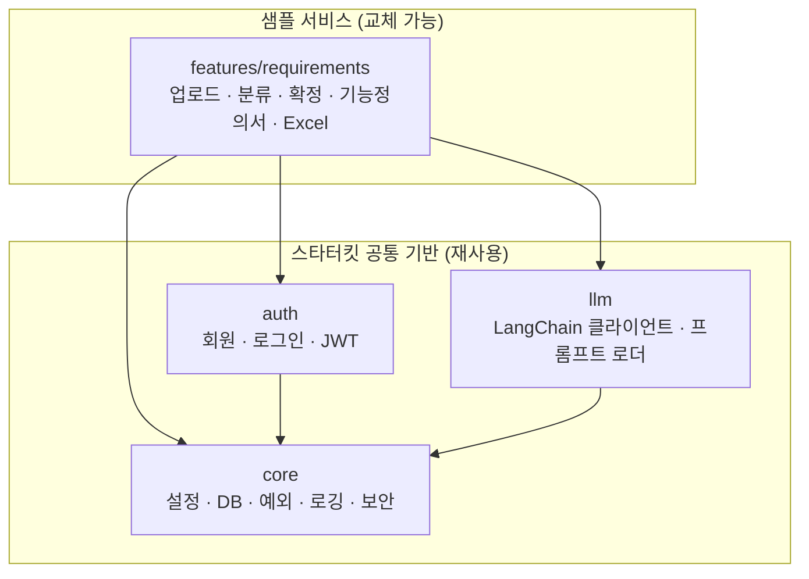

# MeerKit 아키텍처

## 1. 목표

이 저장소는 두 가지를 함께 담고 있습니다.

1. **스타터킷 공통 기반**: 어떤 AI 서비스를 만들든 필요한 설정, DB, 인증, 예외 처리, 로깅, LLM 호출, CI
2. **샘플 서비스**: 공통 기반 위에 만든 예시 기능 "요구사항 정리 도우미"

다른 사람이 이 저장소를 Fork 했을 때 **샘플 폴더만 지우고 자기 기능을 추가**하면 되도록, 두 영역을 폴더로 분리합니다.

## 2. 의존 방향 규칙



- 화살표는 "import 한다"는 뜻입니다.
- **`core`, `auth`, `llm`은 `features/`를 절대 import 하지 않습니다.**
- `features/` 안의 기능끼리도 서로 import 하지 않습니다. 공통으로 필요해지면 공통 기반으로 올립니다.
- 프론트엔드도 같습니다: `shared/`는 `features/`를 import 하지 않습니다.

## 3. 백엔드 구조

```text
backend/
├── app/
│   ├── main.py            # create_app(): 미들웨어, 예외 핸들러, 라우터 등록
│   ├── api.py             # 모든 라우터를 한 곳에서 include
│   ├── core/
│   │   ├── config.py      # pydantic-settings, .env 로딩
│   │   ├── database.py    # engine, SessionLocal, Base, get_db
│   │   ├── security.py    # 비밀번호 해시, JWT 발급/검증
│   │   ├── deps.py        # get_current_user, require_admin
│   │   ├── exceptions.py  # AppException 계층 + 전역 핸들러
│   │   ├── logging.py     # 로깅 설정
│   │   └── models.py      # TimestampMixin 등 공통 컬럼
│   ├── auth/              # router / service / schemas / models
│   ├── llm/
│   │   ├── client.py      # get_chat_model(): 설정값으로 모델 생성
│   │   ├── prompts.py     # 프롬프트 파일 로더
│   │   └── structured.py  # Pydantic 스키마로 구조화 출력 받기
│   └── features/
│       └── requirements/
│           ├── router.py
│           ├── service.py
│           ├── schemas.py
│           ├── models.py
│           ├── parser.py      # MarkItDown: txt/docx/pdf → 텍스트
│           ├── chains.py      # 분류, 정제, 기능정의서 생성 체인
│           ├── prompts/       # *.md 프롬프트
│           ├── excel.py       # openpyxl로 표준 템플릿 채우기
│           └── templates/     # 고정 표준 Excel 템플릿
├── alembic/
└── tests/
    ├── conftest.py        # 테스트 DB, TestClient, Fake LLM
    ├── core/
    ├── auth/
    └── features/
```

### 기능 폴더 안의 역할 나누기

| 파일 | 하는 일 | 하지 않는 일 |
|---|---|---|
| `router.py` | URL, 요청/응답 스키마, 권한 체크 | DB 쿼리, LLM 호출 |
| `service.py` | 업무 흐름 (저장, 상태 변경, 체인 호출 순서) | HTTP 관련 처리 |
| `schemas.py` | API 입출력 Pydantic 모델 | DB 접근 |
| `models.py` | SQLAlchemy 테이블 | 비즈니스 로직 |
| `chains.py` | 프롬프트 + 모델 + 출력 파싱 조합 | DB 접근 |

## 4. 프론트엔드 구조

```text
frontend/src/
├── app/            # App.tsx, router.tsx, providers.tsx
├── shared/
│   ├── api/        # axios 인스턴스, JWT 헤더, 401 처리
│   ├── auth/       # AuthContext, useAuth, ProtectedRoute
│   ├── components/ # Button, Input, Table, FileUpload, Layout
│   ├── hooks/
│   └── lib/
├── pages/          # Login, Signup, NotFound
└── features/
    └── requirements/
        ├── api.ts
        ├── types.ts
        ├── components/
        ├── pages/
        └── routes.tsx   # 이 기능의 라우트 묶음
```

## 5. 공통 규칙

### 설정
- 모든 설정은 `app/core/config.py`의 `settings`를 통해 읽습니다. 코드에서 `os.environ`을 직접 읽지 않습니다.
- 비밀값(API 키, JWT 키)은 `.env`에만 두고, `.env.example`에는 항목 이름만 둡니다.

### 예외 처리
- 업무 오류는 `AppException` 하위 클래스로 던지고, 전역 핸들러가 일관된 JSON으로 바꿉니다.
- 응답 형식: `{"error": {"code": "REQUIREMENT_NOT_FOUND", "message": "..."}}`

### LLM 호출
- 기능 코드는 `llm.client.get_chat_model()`로만 모델을 얻습니다. 공급자를 바꿀 때 `llm/` 한 곳만 고치면 됩니다.
- 출력은 가능하면 Pydantic 스키마로 구조화해서 받습니다.
- 테스트에서는 Fake 모델로 바꿔 끼워 실제 API를 호출하지 않습니다. 그래서 CI에 API 키가 필요 없습니다.

### DB
- 테이블 변경은 반드시 Alembic 마이그레이션으로 합니다.
- 마이그레이션 파일은 한 번에 한 사람만 만듭니다 (충돌 방지).

## 6. 기능을 추가할 때 고치는 곳

공통 기반을 건드리지 않고 아래 세 곳만 수정합니다.

| 파일 | 수정 내용 |
|---|---|
| `backend/app/api.py` | 새 기능 라우터 include 한 줄 |
| `backend/alembic/env.py` | 새 기능 모델 import 한 줄 |
| `frontend/src/app/router.tsx` | 새 기능 `routes.tsx` 등록 한 줄 |

자세한 순서는 [how-to-add-feature.md](how-to-add-feature.md)를 보세요.

## 7. 기술 선택 이유

| 항목 | 선택 | 이유 |
|---|---|---|
| 패키지 관리 | uv | 빠르고 `uv.lock`으로 팀원 간 버전이 정확히 일치 |
| 프론트 | Vite + React + TS | 가볍고 현재 React 생태계의 기본 선택 |
| DB 접근 | SQLAlchemy 2.0 동기 | 비동기보다 디버깅이 쉬움 |
| 비밀번호 해시 | pwdlib[argon2] | passlib 유지보수 중단, FastAPI 공식 문서 기준 |
| 문서 파싱 | MarkItDown | txt/docx/pdf를 하나의 API로 처리 |
| Excel | openpyxl | 고정 템플릿에 값 채우기에 충분 |
| 로컬 DB | Docker Compose | 팀원 간 DB 버전과 설정을 동일하게 유지 |
